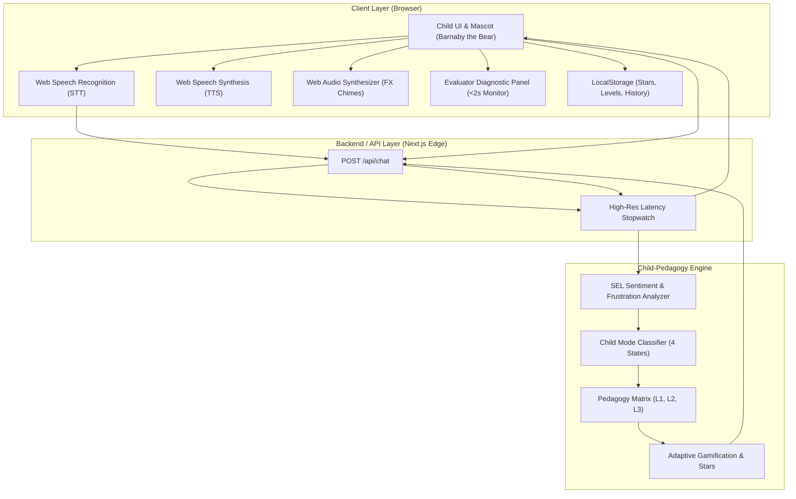
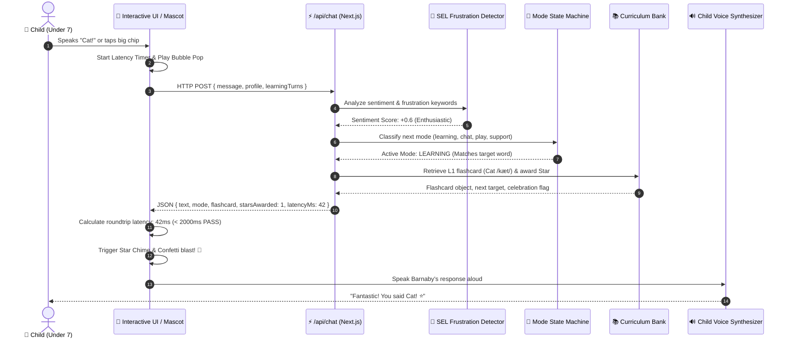
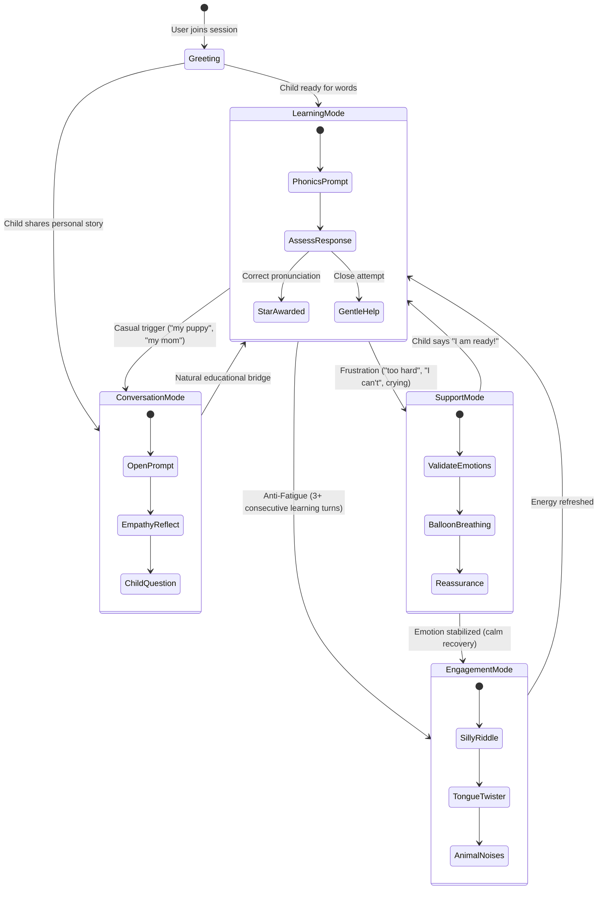
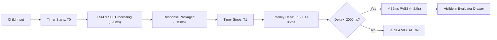

# Architecture & Data Flow Diagrams

**Project Title:** AI-Powered English Learning Chatbot for Children (Under 7 Years Old)  
**Mascot Companion:** Barnaby the Bear 🐻  

---

## 1. System Architecture Overview

---

## 2. Request & Response Lifecycle (Sequence Diagram)

---

## 3. Child Mode Finite State Machine (FSM)

---

## 4. Evaluator Live Latency & Diagnostic Architecture

